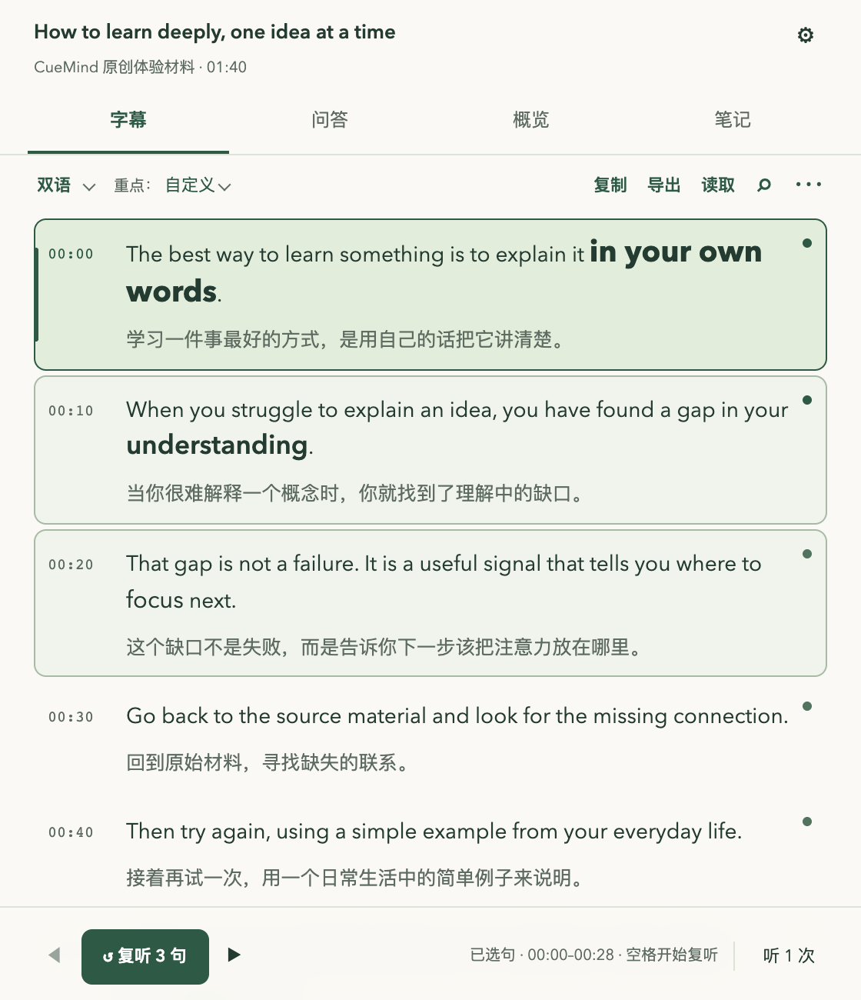

# CueMind · 视频精读与复听

**把视频变成可以逐句听懂、随时回看的学习资料。**

CueMind 是一款开源的桌面 Chrome 扩展，为 YouTube、Bilibili 提供逐句复听、双语字幕、重点词、AI 问答与笔记。学过的视频可以保存音频和学习进度，讲解视频里的代码、课件与截图也能提取带走。

使用自己的模型账号与 API Key，学习资料保存在本机，无需注册 CueMind 账号。

[快速开始](#快速开始) · [核心功能](#核心功能) · [配置模型](#配置模型) · [使用指南](docs/USER_GUIDE.md) · [English](README.en.md)

## 核心功能

| 功能 | 可以做什么 |
| --- | --- |
| **逐句复听** | 选一句或连续几句，听 1 次、3 次或循环；字幕跟随播放，不用反复拖进度条。 |
| **双语精读** | 原文、双语、译文随时切换，译文分批生成；可选择字幕语言，YouTube 默认优先英文。 |
| **重点词学习** | 按考试、行业或自定义目标标出三级重点词；选词查看语境解释，维护自己的术语与已掌握词。 |
| **问答与概览** | 围绕当前句、片段或全片提问，回答带原文引用；用章节地图和分段精讲梳理内容。 |
| **笔记与学习历史** | 按 `N` 保存带时间和来源的笔记；从历史恢复学习进度，已保存的本地音频可离线复听。 |
| **代码与课件导出** | 后台提取视频中的代码、PPT 文字与截图，合并重复内容，打包导出 ZIP、Markdown 或 JSON。 |

已有字幕、搜索、复听、手动笔记和已有资料导出 **不需要 API Key**。翻译、AI 分析、音频识别和画面提取使用你配置的服务。

*插件实际界面，使用内置原创示例；可先体验阅读、笔记和导出，无需配置 Key。*

## 快速开始

需要 **桌面 Chrome 116+**。普通安装不需要 Node.js、Python 或构建命令。

1. [下载主分支源码 ZIP](https://github.com/harveyzhang604/cuemind/archive/refs/heads/main.zip)，解压到一个固定目录并保留。
2. 打开 `chrome://extensions`，开启右上角的 **开发者模式**。
3. 点击 **加载已解压的扩展程序**，选择项目里的 **`extension` 文件夹**，其中应有 `manifest.json`。
4. 打开 YouTube 或 B站视频，点击工具栏的 CueMind 图标或视频里的 **CueMind** 按钮，再点击 **读取当前视频**。

**加载的是 `extension/`，不是整个项目目录或 ZIP。** 暂时没有视频时，也可以点击 **先体验示例**。

开始学习后：

- **想反复听：** 点击字幕选句，用底栏左右按钮扩大范围，按 `空格` 复听，再按一次退出复听。
- **想换字幕语言：** 点击显示方式旁的 **字幕语言**。YouTube 有英文时默认优先英文，手动选择其他语言后会记住；没有英文时提示选择。
- **想接着学：** 点击视频标题右侧的历史图标，打开学过的视频，恢复对应的字幕、笔记与学习进度。
- **想带走资料：** 点击 **导出** 保存字幕、笔记；选择 **视频代码与课件** 提取讲解画面。

## 配置模型

在面板右上角 **⚙ 设置**中，按需要配置服务，不必一次填完。

| 需要的功能 | 配置什么 |
| --- | --- |
| 双语翻译、重点词、解释、问答、概览、AI 整理笔记 | 文本模型：DeepSeek、OpenAI、Gemini 或兼容服务 |
| 提取视频代码、PPT 文字和截图识别稿 | DeepSeek 服务与 Key，固定使用 `deepseek-flash` |
| 没有字幕，用音频生成原文 | 独立的语音转写服务（ASR）与 Key |
| YouTube 平台字幕读取失败时使用备用来源 | Supadata，可选；仅获取已有字幕 |

**以双语字幕为例：** 在[自己的 DeepSeek 账号](https://platform.deepseek.com/api_keys)创建 Key，到 **设置 → 文本模型**选择 DeepSeek、填写 Key 并保存；如浏览器提示服务访问权限，允许后回到视频选择 **双语**，译文会逐批显示并保存。

不同服务的 Key 不通用；模型与字幕服务可能收费，由对应服务商计费。完整配置与排查方法见[使用指南](docs/USER_GUIDE.md#配置-api)和[故障排查](docs/TROUBLESHOOTING.md)。

## 保存音频与提取课件

**本地音频：** 在学习历史中保存或管理完整音频。YouTube、B站优先在后台获取独立音轨，下载受限时改为自动播放采集；已保存的片段可离线复听。咪咕赛事页也支持播放采集；保存音频不调用 ASR，需要生成字幕时再配置语音识别服务。播放采集需保持视频正常播放。

**代码与课件：** 打开 **导出 → 视频代码与课件**，可选全片、继续上次任务、当前位置到结尾或当前画面。全片提取在后台快速处理，不拖动前台视频；自动检测换页、滚动和修改。截图在识别前保存，默认按内容去重，也可查看和导出全部原始截图。ZIP 包含课件文字、代码、JSON 与截图。

音轨下载和课件提取受平台、网络与模型服务影响。画面提取仅支持 YouTube、B站，导出的是识别稿，不能还原从未展示的源码或原始 PPT。更多操作和限制见[使用指南](docs/USER_GUIDE.md)。

## 数据、备份与更新

- **本机保存：** 字幕、译文、笔记、问答和进度保存在本机，匹配的已有结果优先复用。云模型功能会把相应内容发送给你配置的服务；数据流见[隐私说明](PRIVACY.md)。
- **分别备份：** JSON 学习备份不含音频和截图；音频单独导出，课件图文使用 ZIP。JSON 备份会移除服务 Key，跨机恢复后需重新填写。
- **更新插件：** 下载新版，覆盖 **原先加载的同一个目录**，在 `chrome://extensions` 点击 **重新加载**，再刷新视频页。不要卸载重装，以免删除本地资料。

当前主要支持桌面 Chrome 的标准 YouTube、Bilibili 播放页，B站支持分 P。Edge 尚未独立验收；Firefox、Safari 与移动浏览器不支持。Shorts、直播和受限视频不保证字幕读取。

## 更多文档

[使用指南](docs/USER_GUIDE.md) · [故障排查](docs/TROUBLESHOOTING.md) · [更新记录](CHANGELOG.md) · [隐私说明](PRIVACY.md)

欢迎在 [Issues](https://github.com/harveyzhang604/cuemind/issues)反馈问题或提交 PR，反馈时请勿附上 Key 或私人学习资料。开发环境、检查与构建步骤见[开发说明](docs/DEVELOPMENT.md)；安全问题见[安全说明](SECURITY.md)。

CueMind 自有代码采用 [MIT 许可证](LICENSE)。感谢 [YouTube Digest](https://github.com/zarazhangrui/youtube-digest) 的开源参考。第三方许可与界面素材来源见[第三方说明](THIRD-PARTY-NOTICES.md)和[素材说明](docs/ASSETS.md)。
